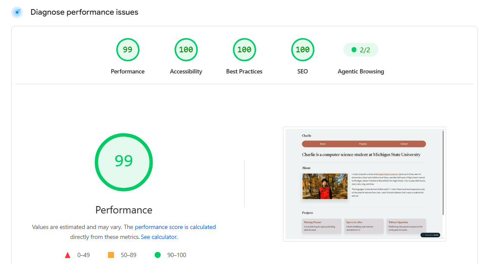

# Accessibility Audit

This document records the accessibility audit of my portfolio site.

## Audit summary

The tool I used for the audit is PageSpeed Insights. My portfolio received an accessibility score of 100.

## Findings

PageSpeed Insights didn't report any failed accessibility audits. My site got a score of 100 on the first run, so I didn't need to fix anything to pass the checks.

I reviewed my code to make sure that:

- **Page language:** the `<html>` element has `lang="en"`, so screen readers use the right pronunciation.
- **Page title:** the document has a `<title>`, so the page has a name in browser tabs.
- **Image alternative text:** the profile photo has descriptive alt text ("Profile photo of Charlie in an autumn park"). It also has `width` and `height` attributes, so the layout doesn't shift while the image loads.
- **Link names:** every link has text that describes where it goes ("About", "Projects", "Contact", "Michigan State University").
- **Colors:** the text and background colors have enough contrast.

## Fixes

No fixes were required. 

## Keyboard testing

I also tested that the website can be navigated by using a keyboard:

- `Tab` to move forward through links
- `Shift` + `Tab` to move backward
- `Enter` to click on a link

## Keyboard navigation video

Video link: https://drive.google.com/file/d/1pyiXiBTj5PP4L1nwUyAU6N_BXmjwPFUX/view?usp=sharing
